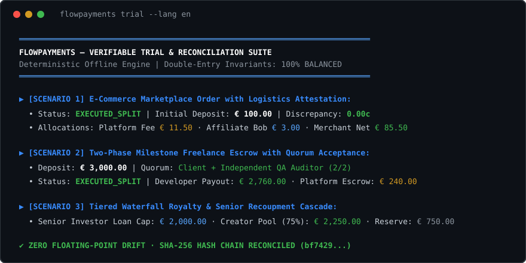

<div align="center">

# FlowPayments

**Simulatore offline deterministico e motore di verifica per pagamenti condizionali, escrow milestone e ripartizioni multi-party.**

[](https://github.com/MRJonam91/FlowPayments/actions/workflows/ci.yml)
[](LICENSE)
[](https://nodejs.org/)
[](package.json)
[](docs/LAUNCH.md)

[Italiano](README.it.md) • [English](README.md) • [Architettura](docs/ARCHITECTURE.md) • [Checklist di Lancio](docs/LAUNCH.md)

<br/>



</div>

---

## 💡 Perché FlowPayments?

I pagamenti condizionali, le ripartizioni per marketplace multi-vendor, gli escrow su stati di avanzamento (milestone) e gli schemi di royalty a cascata (waterfall) sono complessi da testare, riconciliare e spiegare. Spesso i team si affidano a fogli di calcolo vulnerabili agli errori o ad ambienti di staging con carte fittizie e black box bancarie che non consentono di verificare l'esatto percorso di ogni singolo centesimo.

**FlowPayments** offre un ambiente di simulazione locale, deterministico e trasparente:
- **Zero Fondi Reali / Zero Custodia**: Completamente offline. Nessuna credenziale bancaria, nessun token speculativo, nessun rischio normativo.
- **Invarianti Contabili a Partita Doppia**: Aritmetica sicura basata esclusivamente su numeri interi (centesimi). Controllo rigoroso che $\sum \text{debiti} == \sum \text{crediti}$ senza errori di arrotondamento floating-point.
- **Tracciabilità Crittografica Immutabile**: Ogni movimento è registrato in un giornale contabile concatenato con hash crittografici SHA-256.
- **Spiegazioni Trasparenti in Linguaggio Umano**: Genera report dettagliati bilingui e diagrammi di sequenza Mermaid a partire dalla definizione del flusso.
- **Zero Dipendenze a Runtime**: Scritto in moderno TypeScript, eseguibile nativamente su Node.js 22+.

---

## 🚀 Avvio Rapido ​‌​​‌‌​‌​‌​‌​​‌​​‌​​‌​‌​​​‌‌‌​​‌​​‌‌​​​‌​​‌​‌‌​‌​‌‌​​‌‌​​‌‌​‌‌​​​‌‌​‌‌‌‌​‌‌‌​‌‌‌​‌‌‌​​​​​‌‌​​​​‌​‌‌‌‌​​‌​‌‌​‌‌​‌​‌‌​​‌​‌​‌‌​‌‌‌​​‌‌‌​‌​​​‌‌‌​​‌‌

Esegui la suite di prova verificabile in 3 secondi:

```bash
git clone https://github.com/MRJonam91/FlowPayments.git
cd FlowPayments
npm test && npm run trial
```

Oppure direttamente via `npx` (dopo pubblicazione):

```bash
npx flowpayments trial
```

---

## 🧩 Scenari di Simulazione Integrati

FlowPayments include preset standard modellati sui principali pattern fintech e marketplace:

### 1. Marketplace E-Commerce Multi-Party (`marketplace`)
Simula l'ordine di un acquirente da € 100,00:
- Fondi bloccati in escrow fino all'attestazione del corriere di avvenuta consegna.
- Allo sblocco, la ripartizione è atomica:
  - Commissione fissa piattaforma: **€ 1,50**
  - Commissione variabile piattaforma (10%): **€ 10,00**
  - Bonus affiliato referral (3%): **€ 3,00**
  - Netto venditore (resto esatto): **€ 85,50**
- Quadratura contabile: **discrepanza € 0,00**.

### 2. Escrow Milestone per Freelance e Appalti (`milestone`)
Contratto di sviluppo software da € 3.000,00:
- Fase 1 (€ 1.000,00) rilasciata su approvazione del cliente.
- Fase 2 (€ 2.000,00) subordinata a quorum doppio: Approvazione Cliente + Validazione QA indipendente.
- Trattenuta di garanzia piattaforma (8%) su ciascuna milestone e saldo al professionista.

### 3. Cascata Royalty Waterfall (`waterfall`)
Distribuzione dei proventi su € 5.000,00:
- **Scaglione 1**: Rientro del capitale dell'investitore senior fino al cap di € 2.000,00.
- **Scaglione 2**: Creatore riceve il 75% del pool residuo (€ 2.250,00).
- **Scaglione 3**: Margine della riserva di distribuzione sul restante (€ 750,00).

---

## 🛠️ Utilizzo da Riga di Comando (CLI)

```text
flowpayments <comando> [opzioni]
flowpay <comando> [opzioni]

COMANDI:
  trial                 Esegue la prova verificabile multi-scenario con riconciliazione contabile
  sim <flusso.json>     Esegue la simulazione di un flusso da file JSON
  explain <flusso.json> Genera la spiegazione dettagliata e comprensibile del flusso
  validate <flusso.json>Verifica percentuali, regole di resto e riferimenti delle condizioni
  presets               Mostra le configurazioni preset integrate (marketplace, milestone, waterfall)

OPZIONI:
  --mermaid             Genera il diagramma di sequenza Mermaid
  --lang <it|en>        Lingua del report (default: en)
  --json                Restituisce il certificato di audit in formato JSON grezzo
  --help, -h            Mostra questa guida
  --version, -v         Mostra la versione
```

---

## 🏛️ Utilizzo come Libreria TypeScript

```typescript
import { PaymentFlowSimulator, marketplaceSplitPreset, FlowExplainer } from "flowpayments";

// 1. Inizializzazione simulatore
const sim = new PaymentFlowSimulator(marketplaceSplitPreset);

// 2. Deposito simulato nel caveau di escrow
sim.depositSimulatedFunds();

// 3. Attestazione dell'evento di sblocco
sim.submitEvent("cond_delivery_attested", "carrier_status", "DELIVERED");

// 4. Esecuzione ripartizione
sim.executeRelease();

// 5. Verifica riconciliazione di audit
const report = sim.generateAuditReport();
console.log(FlowExplainer.formatAuditReport(report, "it"));
console.log(`Bilancio quadrato: ${report.isBalanced}`); // true
```

---

## ⚠️ Confini e Non-Obiettivi

- **Nessuna Custodia Reale**: FlowPayments non gestisce conti bancari, moneta elettronica o asset crittografici reali.
- **Nessuna Integrazione Gateway Diretta**: Il seed si focalizza sulla modellazione e simulazione; l'integrazione con gateway reali (Stripe, Adyen, Nexi) costituisce un layer a valle separato.
- **Nessuna Consulenza Legale**: Non sostituisce pareri legali o di conformità con la normativa PSD2/E-Money.

---

## ☕ Supporto e Donazioni

FlowPayments è software libero creato da uno sviluppatore indipendente. Se questo strumento ti è utile, sostieni il progetto:

- **GitHub Sponsors**: [github.com/sponsors/MRJonam91](https://github.com/sponsors/MRJonam91)
- **Ko-fi**: [ko-fi.com/mrjonam](https://ko-fi.com/mrjonam)
- **Buy Me a Coffee**: [buymeacoffee.com/mrjonam](https://buymeacoffee.com/mrjonam)
- **PayPal**: [paypal.me/manorollo](https://paypal.me/manorollo)

---

## 📄 Licenza

Rilasciato con licenza [Apache-2.0](LICENSE). Consulta i file [NOTICE](NOTICE) e [LICENSING.md](LICENSING.md) per i dettagli di attribuzione.
