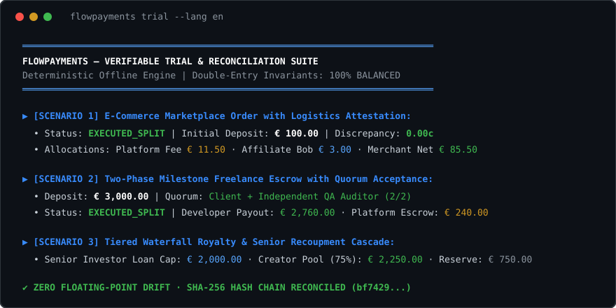
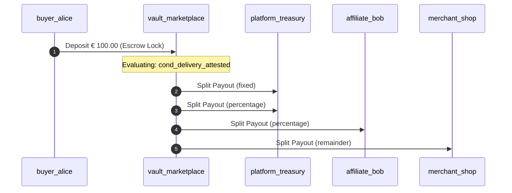

<div align="center">

# FlowPayments

**Deterministic offline simulator & verification engine for conditional, milestone-based, and multi-party split payments.**

[](https://github.com/MRJonam91/FlowPayments/actions/workflows/ci.yml)
[](LICENSE)
[](https://nodejs.org/)
[](package.json)
[](docs/LAUNCH.md)

[Italiano](README.it.md) • [English](README.md) • [Architecture](docs/ARCHITECTURE.md) • [Launch Checklist](docs/LAUNCH.md)

<br/>



</div>

---

## 💡 Why FlowPayments?

Conditional payouts, multi-vendor marketplace splits, milestone escrows, and waterfall recoupment schemes are notoriously hard to test, audit, and explain. Teams often rely on fragile spreadsheets, live staging sandboxes with fake credit cards, or proprietary black-box APIs that fail to trace where every single cent goes.

**FlowPayments** provides a lightweight, local-first simulation environment:
- **Zero Real Funds / Zero Custody**: Completely offline. No real bank credentials, no tokens, no regulatory exposure.
- **Double-Entry Ledger Invariants**: Integer-only cents math. Automatic check that $\sum \text{debits} == \sum \text{credits}$ with zero floating-point rounding errors.
- **Cryptographic Audit Trail**: Every movement is recorded in an immutable journal chained with SHA-256 hashes.
- **Human-Readable Explanations**: Generates transparent bilingual breakdowns and Mermaid sequence diagrams from JSON flows.
- **Zero Runtime Dependencies**: Written in clean, modern TypeScript running natively on Node.js 22+.

---

## 🚀 Quick start ​‌​​‌‌​‌​‌​‌​​‌​​‌​​‌​‌​​​‌‌‌​​‌​​‌‌​​​‌​​‌​‌‌​‌​‌‌​​‌‌​​‌‌​‌‌​​​‌‌​‌‌‌‌​‌‌‌​‌‌‌​‌‌‌​​​​​‌‌​​​​‌​‌‌‌‌​​‌​‌‌​‌‌​‌​‌‌​​‌​‌​‌‌​‌‌‌​​‌‌‌​‌​​​‌‌‌​​‌‌

Run the verifiable multi-scenario test suite in 3 seconds:

```bash
git clone https://github.com/MRJonam91/FlowPayments.git
cd FlowPayments
npm test && npm run trial
```

Or run via `npx` (once published):

```bash
npx flowpayments trial
```

---

## 🧩 Built-in Simulation Scenarios

FlowPayments comes with production-grade presets modeled after standard fintech patterns:

### 1. Multi-Party E-Commerce Marketplace (`marketplace`)
Simulates a buyer depositing €100.00:
- Funds locked in escrow until the shipping carrier confirms delivery via webhook/attestation.
- Upon delivery, splits execute automatically:
  - Fixed platform processing fee: **€ 1.50**
  - Variable sales commission (10%): **€ 10.00**
  - Affiliate referral fee (3%): **€ 3.00**
  - Merchant net payout (exact remainder): **€ 85.50**
- Double-entry balance: **€ 0.00 discrepancy**.

### 2. Two-Phase Milestone Freelance Escrow (`milestone`)
A €3,000.00 software development engagement:
- Phase 1 (€1,000.00) released upon client approval sign-off.
- Phase 2 (€2,000.00) gated by dual quorum: Client + Independent QA Auditor sign-offs.
- Platform escrow guarantee fee (8%) deducted per milestone, net remainder to developer.

### 3. Tiered Waterfall Royalty Cascade (`waterfall`)
Recoupment waterfall for €5,000.00 revenue:
- **Tier 1**: Senior investor principal recoups up to €2,000.00 cap.
- **Tier 2**: Creator receives 75% of post-recoupment pool (€2,250.00).
- **Tier 3**: Distributor reserve retains remainder (€750.00).

---

## 🛠️ CLI Usage

```text
flowpayments <command> [options]
flowpay <command> [options]

COMMANDS:
  trial                 Run verifiable multi-scenario test suite & double-entry reconciliation
  sim <flow.json>       Execute simulated payment flow from JSON definition
  explain <flow.json>   Generate human-readable breakdown of flow splits and triggers
  validate <flow.json>  Verify flow percentages, remainder rules, and condition references
  presets               Display built-in preset configurations (marketplace, milestone, waterfall)

OPTIONS:
  --mermaid             Generate Mermaid sequence diagram (for explain)
  --lang <it|en>        Language for textual output (default: en)
  --json                Output audit results as raw JSON
  --help, -h            Show help screen
  --version, -v         Show version information
```

### Example: Explain a Flow with Mermaid Sequence Diagram

```bash
node dist/cli/index.js explain ./presets.json --mermaid
```

Outputs:


---

## 🏛️ Programmatic Library API

```typescript
import { PaymentFlowSimulator, marketplaceSplitPreset, FlowExplainer } from "flowpayments";

// 1. Initialize simulator with preset or custom JSON definition
const sim = new PaymentFlowSimulator(marketplaceSplitPreset);

// 2. Lock simulated funds in escrow
sim.depositSimulatedFunds();

// 3. Satisfy conditional gates
sim.submitEvent("cond_delivery_attested", "carrier_status", "DELIVERED");

// 4. Release splits
sim.executeRelease();

// 5. Audit reconciliation
const report = sim.generateAuditReport();
console.log(FlowExplainer.formatAuditReport(report, "en"));
console.log(`Balanced: ${report.isBalanced}`); // true
```

---

## ⚠️ Boundaries & Non-Goals

- **No Real Custody**: FlowPayments does not hold or move real money or cryptocurrency.
- **No Direct Gateway Integration**: This seed is a modeling engine and simulator; integration adapters with Stripe, Adyen or banking APIs are intended as separate downstream layers.
- **No Compliance Advice**: Does not substitute legal or payment institution licensing counsel.

---

## ☕ Support & Donations

FlowPayments is open-source software built for developers and researchers. If this tool saves you time or prevents costly accounting mistakes, consider supporting development:

- **GitHub Sponsors**: [github.com/sponsors/MRJonam91](https://github.com/sponsors/MRJonam91)
- **Ko-fi**: [ko-fi.com/mrjonam](https://ko-fi.com/mrjonam)
- **Buy Me a Coffee**: [buymeacoffee.com/mrjonam](https://buymeacoffee.com/mrjonam)
- **PayPal**: [paypal.me/manorollo](https://paypal.me/manorollo)

---

## 📄 License

Licensed under the [Apache License, Version 2.0](LICENSE). See [NOTICE](NOTICE) and [LICENSING.md](LICENSING.md) for attribution and details.
